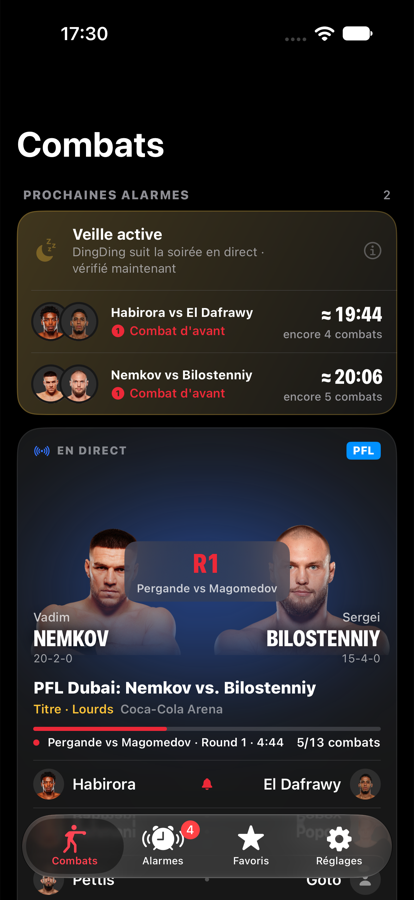
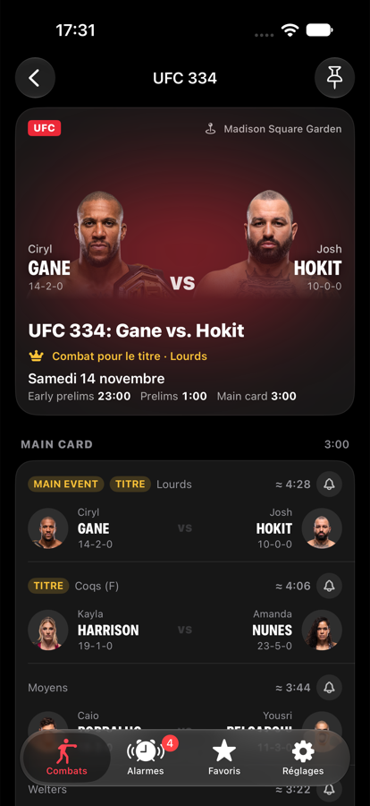
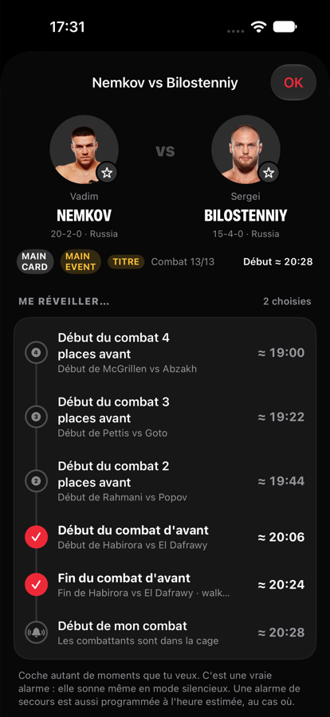

# DingDing 🔔🥊

**L'alarme qui te réveille pile pour ton combat.**

Les soirées UFC et PFL se jouent souvent en pleine nuit en Europe. Le main event peut tomber à 3 h comme à 5 h, selon la vitesse des combats d'avant. DingDing suit la carte en direct et fait sonner une **vraie alarme iOS** (même en mode silencieux) au moment que tu choisis :

- **N combats avant** le tien (1 à 4) ;
- **au début du combat d'avant** ;
- **à la fin du combat d'avant** (les walkouts) ;
- **au début de ton combat**.

<p align="center">
  
  
  
</p>

## Fonctionnalités

- **Cartes UFC et PFL** à venir, avec photos, palmarès, horaires et heure estimée de chaque combat.
- **Suivi en direct** : combat en cours, round, chrono et résultats (KO, soumission, décision…).
- **Veille automatique** : la nuit de l'événement, l'app reste éveillée et suit ESPN toutes les 30 s. Si les combats s'enchaînent plus vite que prévu, l'alarme sonne quand même au bon moment.
- **Alarme de secours** programmée à l'heure estimée, au cas où iOS couperait l'app.
- **Écran verrouillé et Dynamic Island** (Live Activity) : avancement de la soirée et prochaine alarme.
- **Combattants favoris** : une alarme se règle toute seule à chacun de leurs combats.
- **Mode anti-spoiler** : cache les vainqueurs et les méthodes de victoire.
- **Événement épinglé** en haut de l'accueil.

## Prérequis

- Un **iPhone sous iOS 26.1 ou plus** (DingDing utilise AlarmKit).
- Un **Mac avec Xcode 26 ou plus**.
- Un **compte Apple** : le compte gratuit suffit.

## Installer DingDing sur ton iPhone

1. **Clone le projet**
   ```sh
   git clone https://github.com/SweezZze/DingDing.git
   cd DingDing
   ```
2. **Renseigne tes infos**
   ```sh
   cp Config/Local.example.xcconfig Config/Local.xcconfig
   ```
   Ouvre `Config/Local.xcconfig` et mets :
   - ton **Team ID** : dans Xcode → Réglages → Comptes, ajoute ton identifiant Apple, puis lis l'identifiant de ta « Personal Team » ;
   - un **préfixe unique**, par exemple `com.tonprenom`.
3. **Ouvre `DingDing.xcodeproj`**, branche ton iPhone, choisis-le en haut de la fenêtre, puis appuie sur ▶︎.
4. **Sur l'iPhone, la première fois** :
   - active le **mode développeur** (Réglages → Confidentialité et sécurité) ;
   - fais **confiance au développeur** (Réglages → Général → VPN et gestion de l'appareil).
5. **Au premier lancement**, accepte les **alarmes** et les **activités en direct**.

> Le projet est généré avec [XcodeGen](https://github.com/yonaskolb/XcodeGen) (`project.yml`). Après une modification de `project.yml`, lance `brew install xcodegen && xcodegen`.

### La limite des 7 jours (compte Apple gratuit)

Avec un compte gratuit, Apple n'autorise une app installée de cette façon que **7 jours**. Après, il faut la réinstaller. Tes alarmes et tes favoris sont conservés.

Pour ne plus y penser, un script la renouvelle automatiquement depuis le Mac, toutes les 3 h, dès qu'il reste moins de 4 jours. Il faut que le Mac soit allumé et l'iPhone sur le même Wi-Fi (ou branché).

```sh
cp scripts/renew.env.example scripts/renew.env   # mets l'identifiant de ton iPhone
                                                 # (xcrun devicectl list devices)
zsh scripts/install-renew.sh                     # installe la tâche
zsh scripts/install-renew.sh --uninstall         # la retire
```

Avec un compte développeur payant (99 €/an), l'app reste valable un an.

## Pour que l'alarme sonne à coup sûr

- La veille démarre toute seule dans les 24 h qui précèdent un événement où tu as une alarme.
- **Ouvre DingDing avant de dormir** : l'affichage sur l'écran verrouillé est alors relancé pour tenir toute la nuit (iOS le coupe au bout d'environ 8 h).
- **Laisse l'iPhone en charge.**
- **Ne ferme pas l'app** depuis le sélecteur d'apps. Verrouiller l'écran ne pose aucun problème.
- Pour tester sans attendre une vraie soirée : Réglages → **Simulation**, qui rejoue la dernière soirée UFC en accéléré.

## Comment ça marche

| Fichier | Rôle |
|---|---|
| `Services/ESPNClient.swift` | Lit les cartes et le direct depuis l'API publique (non officielle) d'ESPN |
| `Logic/TriggerLogic.swift` | Décide quand une alarme doit sonner et estime les horaires (fonctions pures, testées) |
| `Services/WatchService.swift` | La veille : garde l'app éveillée, interroge ESPN, met à jour la Live Activity |
| `Services/AlarmScheduler.swift` | Les vraies alarmes, via AlarmKit |
| `Services/AppStore.swift` | L'état de l'app (événements, alarmes, favoris), sauvegardé sur l'iPhone |
| `DingDingWidgets/` | La Live Activity (écran verrouillé et Dynamic Island) |

Aucune donnée ne quitte ton iPhone. La seule connexion est vers ESPN.

## Avertissement

Projet perso, sans lien avec l'UFC, le PFL ou ESPN. Les données viennent d'une API ESPN publique mais non documentée, qui peut changer sans prévenir. Garde une alarme classique en plus pour les soirées qui comptent vraiment 😉

## Licence

[MIT](LICENSE)
